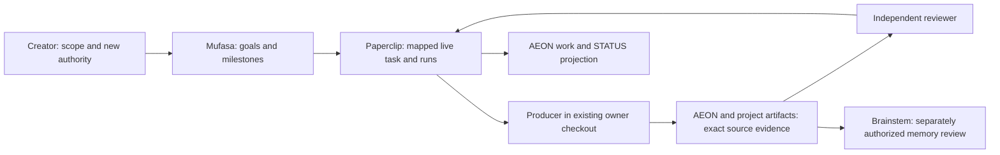

# AEON-EVENTS-001 — Paperclip coordination implementation plan

Date: 2026-10-01. **Disposition: plan ready for independent Astra review; adoption, implementation and activation are not accepted by this document.**

Parent/custodian: **Mufasa**, coordination thread `01a0f1d4-7399-736b-915a-138dc8a2103f`. Planning producer: delegated GPT-6.1 Sol/max; parent reports this task was created with `gpt-6.1-sol`, `max`, default service tier. Architecture reviewer: a separate GPT-6 Astra/xhigh task, commissioned by Mufasa after this handoff. Producer verification below is document verification, not reviewer acceptance.

This extends the existing **AEON-EVENTS-001** owner in [the work index](../README.md). The creator owns decisions and new authority; Mufasa owns assignment, milestones, progress, blockers and the next permitted action. Paperclip is a candidate for live orchestration. Brainstem retains memory/admission authority and project code; AEON retains task navigation and authored artifacts. No additional task framework or independent queue is proposed. [L1–L4]

## 1. Goal and useful completion

Move goal/task/milestone-driven work through named ownership, independent review, repair and verified completion. Preserve exact source, unfinished checks, gate and next action across interruption. Mufasa sees stalled work while healthy tasks continue.

First useful result: **one synthetic task with an independent verdict, exact handoff, recoverable checkpoint and consistent Paperclip/AEON state**. Measure missed/duplicate handoffs, recovery, unnecessary wakes and coordinator effort. Roster growth and memory utility remain later milestones. [L1–L4]

Current scope is source research and this planning document only. No Paperclip install/server, credential setup, model invocation through a local account, native AYA launch, service/cron, security change, private store access or installed AYA/Hermes configuration change occurs here.

## 2. Verified baseline and limits

Local Git readback at **2026-10-01T06:02:05.778641+00:00** established these revisions and worktree states. Runtime results below are inherited dated receipts, not rerun tests or a fresh service inventory.

| Fact | Evidence and implication |
|---|---|
| AEON source owner | HEAD `16039bd1b7d625a98a04e269c69fbf5bfa900c06`; existing untracked `.trigger-tree/` retained. `AGENTS.md`, `PROJECT.md`, `STATUS.md`, `DECISIONS.md`, `work/README.md` govern navigation and coordination. |
| Existing Paperclip installation | `~/.paperclip/cli/install.json` records **npm CLI `2026.916.1`, pinned**, payload `~/.paperclip/cli/installs/npm/2026.916.1`. Existing source checkout `/home/aya-hmw/aya/projects/paperclip` is clean at **`d554c4789ed3930f8a53ac9fdf6503b3187097da`**. Reuse these owners; no reinstall is proposed. The npm payload is not assumed identical to this source revision. Runtime, company, agents and integration were **not queried/verified**. [L6] |
| Original Brainstem checkout | `/home/aya-hmw/aya/projects/developmental-lab/brainstem`, HEAD `26e5de877ac3a703e2b4e0c7faab9d43598c68be`, **63 dirty entries**. Preserve these; use existing separately owned AEON worktrees for approved implementation. [L2] |
| Current native continuation | `AEON/worktrees/brainstem-native-recall`, clean at `69d7cdce7ae78a5c70f2dae5403be698d4ac7ef0`. Source libraries for the successful PG check were `f625984a47e9d5c83f778a63e150ca735aa57ae9`; `74df0643f90e37009ec5554a5894ec9195112f2c` is its receipt checkpoint. [L3] |
| Actual PG integration | **12 passed / 0 failed / 0 not run**, exactly three identity plus nine tool reads; graceful stop/PID0 recorded. This qualifies the fixed synthetic consumer path, with latest-only source/history limits. It does not qualify a native model-to-PG session or production memory. [L3] |
| Native AYA test | **Never launched**: two automatic approval denials did not recognize forwarded owner permission for account/identity-provider effects. Zero native/model launches; no runtime clock. No further retry or alternate route is authorized. Mufasa/platform own recognized authorization recovery. Paperclip cannot bypass it. [L3] |
| Native delivery | Existing `~/.aya/bin/aya-codex`, `~/.aya/codex`, `~/.aya/workspace` remain their owners. Intended Brainstem delivery is a **Codex plugin**; the tested MCP facade is not verified installed-plugin packaging. [L3] |
| Existing event work | B4 handoff, late-publication receiver and snapshot publisher have separate offline source/receipts. Runtime publication, complete selection, receipt remits, shared writer control and historical reconciliation remain gates. `.trigger-tree/` metadata is not evidence of a deployed dispatcher. [L4] |
| Memory and utility | Brainstem HLD/Guide retain proposed durable PG, derived Qdrant and disposable Redis roles. Firecrawl stores remain distinct. Exposed M4/N4 comparison ended in four ties/delta0; `utility_qualified=false`, `release_evaluated=false`. [L2–L3] |

Dictionary/native IDs remain distinct; no shared-ID migration. Codex memories supplement current evidence; old World Wiki references are superseded by its recorded removal. No Cloud/Notion/Basic Memory Cloud read occurred. [L2, L5]

## 3. Paperclip fit and adoption constraints

Official documentation was reopened on 2026-10-01. Live pages and `master` references are not the installed npm payload. M1 reconciles **the existing pinned installation** with its source/release before choosing any update. Local Paperclip AGENTS and its `paperclip`, `paperclip-board`, and `paperclip-converting-plans-to-tasks` skills were read. The explicit AEON file-planning scope governs this task; no Paperclip API onboarding, plan upload, task creation or approval occurs here. [L6]

| Existing Paperclip capability | Design consequence |
|---|---|
| Issue checkout requires `POST /api/issues/{id}/checkout`, `expectedStatuses`, and agent `X-Paperclip-Run-Id`; `409` rejects contention. Review/status transitions and typed blockers are documented. [P3] | Reuse native checkout and dependency paths; a status patch is not a work claim. A stale-looking lock alone is insufficient to reassign work. |
| Assignment and comments can wake dormant agents; timer heartbeats are optional. [P4] | Event wakes drive handoffs. Keep worker interval wakes off; use explicit waiting paths for dependencies and approvals. |
| Execution policies enforce ordered review/approval and route requested changes back to the executor. [P5] | Configure a real independent review path rather than relying only on a prompt asking the producer to obtain review. |
| Codex adapter exposes model/effort/fast settings, manual model IDs, session persistence and managed-home behavior. Its environment test includes a **model hello probe**; managed homes can inherit host authentication. [P1] | Model support and account boundaries need explicit verification. Do not treat the environment test as a harmless metadata check or allow default auth inheritance without authorization. |
| Hermes adapter uses Hermes's own model configuration rather than an adapter `model` field. [P2] | A requested model matrix cannot be enforced by inventing Hermes adapter fields. Leave installed Hermes/AYA untouched. |
| Current execution semantics distinguish ownership, dependencies and execution; active-run silence is informational. Source recovery may invoke normal configured models. [P6] | Reuse liveness evidence, but include automatic recovery in scope/budget. It must never restart the blocked native attempt. |
| Task watchdogs inspect stopped trees. Public Codex docs say **seven-minute** inactivity default; local `d554c47` source says **30 minutes**, with `null` disabling it. [L6, P1, P7] | Docs/source differ. The installed npm payload and every termination layer need validation; informational health is distinct from process termination. |
| Workspaces support existing paths and Git worktree isolation; budget policies track scoped spend and can prevent further wakes. [P8–P9] | Preserve existing checkouts. Reported cost controls do not prove a provider-side hard request/token cap or subscription-quota ceiling. |

Paperclip can replace bespoke live dispatch if the gates below pass. Reuse its issue/run/approval system; do not add Redis polling, another event bus, or parallel cron dispatch. If the exact account, recovery or inactivity controls cannot meet this scope, retain the current platform/manual coordination and record the unsupported capability. [P1–P9]

## 4. Exact roles and model contract

Record **requested**, **accepted configuration**, and **observed execution** separately. Unsupported settings never trigger an unapproved model/effort/provider/tier substitution.

| Role | Requested model / effort | Responsibility and gate |
|---|---|---|
| Mufasa parent | Existing parent model; no new model/effort requested | Own task custody, priorities, one assignee per stage, dependencies, budgets, blockers, current milestone and review handoff. Cannot self-sign independent acceptance. |
| Plan producer / rejected-plan revision | **`gpt-6.1-sol` / `max` / normal speed** | Produce and revise this plan against evidence and Astra findings. Parent reports creation with default tier. Effective provider tier is not independently observed by this document. |
| Architecture review | **`gpt-6-astra` / `xhigh`** | Independently accept, reject or request changes to an exact plan digest; review boundaries, synchronization, recovery and proportional scope. |
| Code implementation | **`gpt-6.1-sol` / `high`** | Implement the accepted, authorized milestone in its owning checkout; preserve unrelated work and publish source-bound evidence. Starts only after plan acceptance and applicable scope authorization. |
| Independent code review | **`gpt-6.1-sol` / `medium`** | Fresh reviewer task/session checks exact implementation bytes and relevant behavior; reviewer does not change criteria to fit the patch. |
| Codebase search | **`gpt-6-luna` / effort unspecified by creator** | Separate read-only source/owner/call-path map with exact locations and unresolved coverage. Parent supplies this work; no invented effort setting. |
| Web research | **`gpt-6-luna` / effort unspecified by creator** | Separate current primary-source research, dates/URLs, capability limits and contradictions. Parent supplies this work. |
| Difficult error diagnosis | **`gpt-6-astra` / `xhigh`** | Bounded diagnosis when source-grounded local repair stalls; give reproduction, failed attempts, exact effect/permission boundary and a stopping point. This grants no account retry or new effects. |

The OpenAI model page supports Sol `max`, `high` and `medium`; Paperclip's indexed model list currently omits `gpt-6.1-sol`, while manual IDs pass through. That establishes a plausible route, **not verified compatibility for a selected Paperclip/Codex version**. Validate accepted and observed model/effort metadata before model-bearing dispatch. [P1, P10]

For normal speed, omit `fastMode` (or explicitly set it false) and verify the **effective** tier: an existing Codex profile can still set `service_tier=fast`. Parent reports an explicit default tier for this planner; provider delivery is not independently observed here. Unsupported/unobservable settings are recorded without substitution. Luna effort remains unspecified; Mufasa retains its parent setting. [P1]

The initial Paperclip roster is **Mufasa + Sol/high producer + Sol/medium reviewer**. Parent's separate Luna work and external Astra architecture gate do not expand that live roster.

## 5. One task state authority and existing artifact owners

Until cutover, existing `work/` owners and platform/manual events govern. If adopted, **Paperclip owns live lifecycle, assignee, locks, dependencies, reviews and runs for the mapped task**; AEON projects them with evidence/checkpoints. Brainstem retains memory/admission authority.

Reuse `AEON-EVENTS-001`; register only genuinely distinct later tasks in `work/README.md`. Crosswalk native company/project/issue/run IDs to existing owner paths. Local projection labels are not new Paperclip API properties.

| State/evidence | Writer and synchronization rule |
|---|---|
| Live issue, stage owner and dependencies | Paperclip's authorized current participant under native checkout/policy. Mufasa routes the permitted next stage; parent/child structure is not a dependency by itself. |
| Task objective, milestones, approved scope and done criteria | Existing task owner; freeze the version/digest reviewed. Evidence corrections do not silently change the criterion. |
| Source outputs and checks | Producer writes owned files in the project checkout; immutable manifest names tracked plus selected untracked bytes, failures and unfinished checks. Reviewer writes its own result. |
| AEON lifecycle projection | Mufasa/custodian is the sole projection writer. Preserve owner-authored evidence; compare current bytes, serialize the write and replace atomically. Producer/reviewer do not concurrently edit root status. |
| Brainstem memory | Existing memory/admission owner only. A completed task, Paperclip comment or cached summary is not an admitted memory. |

Projection fields: issue/run references, lifecycle/assignee/stage, native status version or digest, last applied activity reference, checkpoint locator, synchronization result/time. Lifecycle maps `backlog/todo` to queued, `in_progress/in_review` to active, `done/cancelled` to a closed disposition; `blocked` retains its explicit gate. Existing folder indexes do not dispatch or move receipt owners. Human edits are reconciliation proposals, never a second queue.

After adoption, the native issue `plan` document carries the exact approved AEON plan revision/digest as an operational projection. Update it using current `latestRevisionId` → `baseRevisionId`; reconcile conflicts rather than overwrite. Create any accepted execution issue with `initialPlan` before event wakes can run it. Register outputs as native work products with a supported `workspace_file` resource reference and digest; verify reviewer access. Remote reviewers need an authorized safe artifact/view, not merely a host path. [L6]

Recover from canonical issue/run/activity plus exact artifact receipts. Unknown issue-update outcomes reconcile before another effect; failed projections replay idempotently. A stale AEON header never overwrites newer live state. Contested evidence gets a `sync_conflict` annotation and named owner/action, not guessed completion.

Checkout supplies an atomic claim, not filesystem fencing or cross-store transactions. M1 validates supported state-version checks and an owned file-write guard; no generic `PATCH If-Match` or idempotency header is assumed. Do not borrow `.trigger-tree/write.lock` or run legacy Hermes B4 and Paperclip as competing dispatchers. Luna found no existing Brainstem/AEON integration references; legacy README live-unit prose and an absent expected unit symlink do not establish current service state. No systemd query was performed. [L1, L4, L6, P3, P6]

## 6. Event, ownership, completion and resume contracts

Keep task, attempt, native run and event identities distinct. Reuse native activity/comment IDs and existing Dictionary meanings. Delivery is at-least-once with idempotent effects. [L4–L5]

Each handoff references: task/attempt and stage; current named owner; native issue/run/event identity; expected prior state; approved scope/budget reference; exact source commit plus manifest digest; completed/failed/not-run checks; checkpoint and next action. No credentials, raw sessions, private identity bodies or hidden reasoning enter task comments or navigation Git.

| Event | Required evidence and next action |
|---|---|
| `task-ready` | Current goal/milestone, accepted plan/criteria, dependencies resolved, allowed effects and remaining budget. Current assignee checks fresh canonical state and checks out atomically. A `409` stops that claim; no lock-thrashing retry. |
| `blocked` | Typed dependency, approval/interaction, or valid unblock descriptor. Agent-authored descriptors may name only the allowed agent owner; human/board input uses a saved pending interaction and review wait. Preserve both native denials/not-run denominators. A watchdog or reassignment cannot clear that permission gate. [L6] |
| `review-ready` | Producer run, immutable selected source manifest, relevant test receipts and unfinished limits. Independent reviewer checks the exact bytes; starting later or receiving a wake is not acknowledgement. |
| `changes-requested` | Reviewer-authored findings against the frozen criterion; return to original producer with one permitted next milestone. Retain rejected revisions and source drift. |
| `completed` | Exact reviewed artifact and reviewer decision plus criterion/evidence class. Runtime exit/succeeded status alone cannot complete the deliverable. Mufasa publishes the projection and advances only eligible dependencies. |
| checkpoint/resume | Source revision/digests, remaining plan/checks, last effect and known/unknown outcome, native session/attempt references if available, cleanup/ownership state and remaining budget. Reopen these before resume. Missing resumable session evidence never becomes a fresh replacement by inference. |

Duplicate/stale events cannot duplicate effects or regress state. Partial receipts cover only named snapshots; unknown effects require readback/reconciliation. Publication is not review acceptance. [L4]

## 7. Milestones and phased implementation

| Milestone | Owned work, dependencies and acceptance |
|---|---|
| **M0 — accepted plan** | Mufasa supplies this exact digest and separate Luna findings to fresh Astra/xhigh. Sol/max revises rejected plans and maps each finding to revised evidence; Astra rechecks. No self-approval or local account/runtime authority follows. |
| **M1 — offline contract and adapter slice** | After accepted review and bounded code scope, Sol/high pins Paperclip/Codex versions and implements only the smallest projection/evidence mapping in the existing AEON tool owner or existing Brainstem automation owner, as the accepted contract assigns. Prefer native Paperclip behavior; no scheduler/queue rewrite. Reuse source-publication/receipt contracts. Use a separately owned existing worktree when code edits collide. Fresh Sol/medium review checks exact bytes and the relevant contract cases below. No services/accounts needed for this milestone. |
| **M2 — finite model-free pilot** | Reuse installed Paperclip after a concrete startup packet covers listener, isolated runtime state and cleanup. One scripted coordinator plus two **fixture workers** test transport/protocol; they do not substitute for or validate requested models. Validate the built-in process/API lane, with no auth inheritance/provider calls. Proposed runtime child: existing ignored `AEON/var/paperclip-pilot/`, separate from Brainstem/Firecrawl. Foreground only, no daemon/cron; pass handoff/contention/quiet-worker/crash/projection cases, then stop owned resources. |
| **M3 — finite model-bearing pilot** | Same three identities: existing Mufasa route, Sol/high producer and independent Sol/medium reviewer. Requires verified exact settings, recognized account/provider/bookkeeping authority, safe connector policy, bounded recovery/preflight calls and approved budget. One synthetic task: producer emits a source-bound handoff manifest from disposable allowlisted fixtures; reviewer independently reads/verifies it; Mufasa synchronizes disposition. No AYA identity, production memory or blocked native controller. Pass source/review and model observations; preserve rejected/not-run rows. |
| **M4 — useful project lane, then measured expansion** | Map one already authorized project task only after M3 demonstrates benefit over manual/platform coordination. Resolve native AYA authorization and intended Codex-plugin delivery through their existing task owners before any native memory lane. Admit no memory from task success alone. Add Luna search/research or Astra error roles one at a time only with their own effects/budgets; no larger roster activation inferred. |

Pilot: ready/claim → artifact/checkpoint → independent review → consistent projection → interruption replay → owned stop. Rejection returns the failed milestone. Two same-approach failures trigger bounded diagnosis/change of strategy, with no extra budget or stop-gate bypass. [L1]

Minimal future task graph (no issues created now):

| Work boundary | Owner / initial state / dependency |
|---|---|
| Existing planning task | Sol/max producer; ready for external Astra/xhigh review. Separate reviewer boundary, exact digest; no implementation children before acceptance. |
| One end-to-end pilot task | Sol/high producer; backlog until accepted plan plus recognized activation/budget gates. Internal milestones stay a checklist, not separate phase issues. |
| Pilot code acceptance | Sol/medium review **stage on that same issue**. If reviewer trust/access requires a separate review issue, that is the qualifying independent boundary; parent uses `blockedByIssueIds`, reviewer posts on its own issue and completes the verdict even when findings reject the code. |

Mufasa verifies the actual agent identities/specialties before assignment and re-fetches the created plan/dependency graph. Role names and a CEO title grant no board or API identity. [L6]

Fallback: retain platform/manual coordination if runtime gates fail; preserve model-free results if model gates fail. The native memory lane remains separately gated.

## 8. Proportional verification and acceptance

**Planned checks, not claimed passes.** Reuse existing relevant fixtures/criteria; test coordination races, authority and recovery proportionally. Record pass/fail/not-run/unknown and separate source/fake, actual integration, deployment and production evidence. [L1, L4, P11]

| Check group | Observable pass condition |
|---|---|
| Single ownership/contention | Simultaneous claims result in one owner; a losing `409` creates no edit/run retry. Native checkout does not replace the file-write guard. |
| Event duplicate/order | Replayed wake/activity causes no duplicate model run, handoff or state regression; burst coalescing cannot swallow a distinct required stage. |
| Exact review/non-self-acceptance | Wrong run/digest, failed/incomplete reviewer, changed/unselected untracked bytes and producer self-approval cannot complete work. Reviewer rejection returns to the correct source milestone. |
| Synchronization | Crash before/after artifact, issue and projection publication converges through readback; divergent human edits are retained for reconciliation. No second dispatch occurs from AEON. |
| Resume/uncertain effects | Preserve acknowledged checkpoints and remaining budget; unknown outcome reconciles before replay. Missing session/receipt stays missing. Healthy active ownership is not stolen. |
| Liveness/quiet work | A long permitted quiet operation remains alive; health attention is informational. Terminal worker with unfinished work gets one owned next path within the approved recovery bound; unchanged genuine blockers do not loop. |
| Boundary/permissions | Injected native denial remains blocked, with zero launch/retry/model effect. Unauthorized connector action, provider change, safety bypass or private-source read fails closed. |
| Cancellation/budget | Recheck canonical cancellation before new effects; no late successor dispatch. Exhausted or unobservable required budget stops new model wakes and retains checkpoint/owner. |
| Exact model settings | Configured and accepted model/effort/normal tier are observed where supported. Unsupported/missing metadata is explicit and cannot silently select a substitute. Scripted M2 does not satisfy this case. |
| Artifact and custody | Independent readback validates the pilot artifact against frozen criteria; original63 dirty entries, source pins, native config pins and historical receipts remain preserved. |
| End/rollback | Final finite resource/process ledger proves owned stop/cleanup; no service/autostart, leaked listener, private export or accidental follow-up wake. |

Pass requires exact receipts and independent acceptance of the intended evidence class. Preserve denial/not-run and zero-gain results. Expansion needs no lost handoff, duplicate effect or healthy-task termination, plus measured coordination benefit.

## 9. Stalled-work detection and observability

Mufasa's view: goal/milestone, owner/participant, last **durable progress**, live run/tool state, expected checkpoint, blocker owner/action, review age, sync status and budget. Progress means an artifact/check/disposition change; process success cannot hide incomplete work.

At dispatch, record a task-appropriate checkpoint expectation and known quiet interval. If it is exceeded, inspect live process/tool evidence and native run state; request a checkpoint or raise informational attention. Do not kill or reassign healthy work because a universal age threshold passed. Genuine shutdown happens for a creator cancellation, approved finite hard resource/deadline bound, confirmed failed process, or actual authority/safety/budget gate, with checkpoint and an exact owned cleanup receipt.

**Quiet-work compatibility gates activation.** Reconcile public seven-minute/one-hour wording with local 30-minute monitor and informational silence semantics; verify the installed payload. Validate `null` disable/scoping, a quiet-worker case and all termination layers. An unconfigurable arbitrary kill makes that version unsupported for this use. Watchdog recovery also consumes a bounded permitted model budget. [L6, P1, P6–P7]

Use native issue/activity/run views and existing artifact routes for correlations, milestone/latency/stall/duplicate/recovery/usage evidence and unknowns. Synthetic Tempo receipts do not authorize real capture/export. Grafana/Tempo wiring is optional later work. [L1, L3]

## 10. Budget, permissions and rollback

No local-account model budget is consumed here. M1 uses accepted parent/platform source-only scope. Proposed M2 envelope: **one foreground instance, three scripted identities, one synthetic task, ten minutes including cleanup**, zero provider calls. Startup still needs authority.

For M3, prepare one concrete packet covering coordinator/worker calls, model hello probes, initialization/strategy, recovery and retries. Suggested starting envelope: one producer run, one independent review run and at most one necessary coordinator run; any preflight/recovery must fit explicit additional reserved slots, otherwise remain off/blocked. Specify deadline, token/dollar/provider-request controls actually available, current subscription allowance and normal bookkeeping. **Dollar/token caps are unresolved here; time and main-run counts alone cannot guarantee a hard provider-spend cap.** Unknown usage is unknown, not zero. Repair within an accepted allowance continues normally; an exhausted allowance needs a new budget decision, not an invented substitute. [P1, P6, P9]

Before activation inventory connector actions (some may default Allowed), auth inheritance, skills/home writes, workspace hooks and automatic recovery. Paperclip local source also distinguishes **opt-out first-party telemetry**, opt-in OTLP observability and local run logs. The pilot must suppress outbound telemetry using a validated isolated-instance control (`PAPERCLIP_TELEMETRY_DISABLED=1` exists in inspected source) and verify its effective behavior. No installed setting is changed now. Reversible effects still require authority; tutorial sandbox bypass, native AYA/Hermes identity/configuration, paused schedules, production stores and private export remain outside the packet. [L1–L3, L6, P1–P2]

Rollback: stop **only pilot-owned** dispatch/wakes and foreground resources; reconcile active runs and uncertain effects before changing ownership; preserve issue history, checkpoints, failed receipts and produced source work. Export a safe final state projection, then return the mapped task explicitly to platform/manual coordination. There must never be two active dispatch authorities during cutover or rollback. No history reset, dirty-work discard, provider cutover, database rollback or installed-config restore is part of this plan. If future activation changed any owned setting, its packet must specify exact restoration/readback.

## 11. Compact role prompts

Use task-local context/source links. Audit conflicting instructions; current authority and source/runtime win. Verify proportionally without removing mandatory gates. [P11–P12]

Common task envelope:

> Goal: {user outcome}. Task/attempt: {IDs}. Milestone: {bounded result}. Read {applicable instructions, source owners, accepted plan/digest, current checkpoint and review findings}. Authority: {permitted reads/edits/effects}, budget: {remaining known bounds}; unsupported settings: {explicit}. Use {actual available tools} to produce {exact owner path/artifact contract}. Verify {relevant criterion/checks}, preserve failed/not-run evidence and checkpoint before handoff. Finish at {milestone/gate}; record owner, evidence, unfinished work and next permitted action. No implicit successor effects.

| Role | Task-specific addition |
|---|---|
| Mufasa | Pick the next dependency-ready milestone; name one participant, exact model settings and bounded scope. Verify disposition and stalled/waiting paths from native evidence; serialize AEON projection. Route independent review and escalate only a material scope/authority/budget change. |
| Sol/max planner | Reconcile sources and alternatives into a compact implementable plan. On rejection, resolve each Astra finding or retain a source-backed disagreement; submit revised digest for independent review. |
| Astra/xhigh reviewer | Review {plan digest} independently for goal fit, owners, authority, state synchronization, recovery, model compatibility and sufficient proportional checks. Return accept/changes-requested/reject, material findings with sources, and exact acceptance conditions. Do not install, activate or certify your own producer work. |
| Sol/high implementer | Implement only {accepted milestone} in {owning checkout}; preserve dirty work, use relevant existing tests and ordinary authorized fixes, publish exact source/evidence and independent-review handoff. Stop at new-effect/budget gates. |
| Sol/medium reviewer | Inspect immutable {commit/selected manifest} independently and read back the required behavior. Return source-bound findings/verdict, checked/not-checked cases and remaining limits; do not broaden criteria or approve mismatched bytes. |
| Luna source search | Map the existing owners, entrypoints, tests, contracts and active/paused mechanisms for {question}. Read only the relevant sources; return exact locations, dated facts, contradictions and unopened gaps. |
| Luna web research | Answer {bounded capability question} from current official docs/source, with URLs/dates/version limits. Separate product claims from local deployment evidence; report unsupported or contradictory settings. |
| Astra/xhigh diagnosis | Diagnose {reproduction and exact failures} within {authorized source-only or specific effect scope}. Propose the smallest repair and observable check. A denial does not authorize retries, account changes or indirect execution. |

## 12. Open decisions, source register and review handoff

Remaining decisions: installed-payload/source mapping and supported Mufasa transport; projection writer/lock binding; selected-version recovery/quiet-worker controls; effective models/tier; recognized account/bookkeeping authority; budget/preflight/recovery counts; and separate native permission/plugin delivery. Luna located the title **Astra guide.md** through context but did not retrieve its exact path/body. The older `memory-repair-orchestration/ASTRA-TASK.md` is a different bounded review; neither is a substitute for current API evidence or applicable AGENTS.

Parent-supplied **separate Luna local and web findings are incorporated**, including installed Paperclip, owner/source map, legacy dispatch conflict, exact settings and effective-tier limits, and task-specific prompting/proportional checks. Mufasa retains the original research packets for Astra. This author independently reopened the sources below; role requests are not execution receipts.

Local sources actually read:

| Ref | Authoritative existing owner |
|---|---|
| L1 | [AEON AGENTS](../../AGENTS.md), [PROJECT](../../PROJECT.md), [STATUS](../../STATUS.md), [DECISIONS](../../DECISIONS.md), [work index](../README.md), [resource routes](../../resources/README.md), [output routes](../../outputs/README.md), [Bible navigation](../../bibles/README.md). |
| L2 | [Brainstem AGENTS](/home/aya-hmw/aya/projects/developmental-lab/brainstem/AGENTS.md), [primary architecture](/home/aya-hmw/aya/projects/developmental-lab/brainstem/architecture.html), [retained Guide](/home/aya-hmw/aya/projects/developmental-lab/brainstem/docs/review-packets/2026-09-29-hld-convergence/Guide.md), [HERMES owner routing](/home/aya-hmw/HERMES.md), [worktree custody](../../docs/worktree-relocation-2026-09-30.md). |
| L3 | [PG task](../completed/AYA-PG-008.md), [PG receipt](../../worktrees/brainstem-native-recall/docs/reports/2026-10-01-pg-consumer-read-smoke/README.md), [blocked native task](../queued/AYA-NATIVE-CORR-009.md), [two-denial report](../../worktrees/brainstem-native-recall/docs/reports/2026-10-01-native-correction-blocked/README.md), [AYA workspace AGENTS](/home/aya-hmw/.aya/workspace/AGENTS.md), [AYA foundation skill](/home/aya-hmw/.aya/workspace/.agents/skills/aya-foundation/SKILL.md). |
| L4 | [Existing handoff contract](../../worktrees/brainstem-handoff-coverage/automation/README.md), [handoff source](../../worktrees/brainstem-handoff-coverage/automation/event_handoff.py), [publication receiver](../../worktrees/brainstem-publication/docs/reports/2026-10-01-publication-reconciliation/README.md), [snapshot publisher](../../worktrees/brainstem-snapshot-publication/docs/reports/2026-10-01-snapshot-publication/README.md). |
| L5 | [Continuity owner check](../../docs/continuity-owner-check-2026-10-01.md), [local Dictionary](</home/aya-hmw/da-cloud/aya-development/Architecture/AYA Schema, Tag, ID and Data-Contract Source Catalog — 2026-09-22.md>), [Codex memory summary](/home/aya-hmw/.codex/memories/memory_summary.md), [Codex second-brain skill](/home/aya-hmw/.codex/skills/codex-second-brain/SKILL.md), [vault instructions](</home/aya-hmw/Documents/Codex Brain/AGENTS.md>), [vault index](</home/aya-hmw/Documents/Codex Brain/wiki/index.md>). Supplementary notes do not override current source owners. |
| L6 | [Paperclip AGENTS](/home/aya-hmw/aya/projects/paperclip/AGENTS.md), [installed CLI metadata](/home/aya-hmw/.paperclip/cli/install.json), [paperclip skill](/home/aya-hmw/aya/projects/paperclip/skills/paperclip/SKILL.md), [board skill](/home/aya-hmw/aya/projects/paperclip/skills/paperclip-board/SKILL.md), [plan-to-tasks skill](/home/aya-hmw/aya/projects/paperclip/skills/paperclip-converting-plans-to-tasks/SKILL.md), [issue schema](/home/aya-hmw/aya/projects/paperclip/packages/db/src/schema/issues.ts), [dependency schema](/home/aya-hmw/aya/projects/paperclip/packages/db/src/schema/issue_relations.ts), [work-product schema](/home/aya-hmw/aya/projects/paperclip/packages/db/src/schema/issue_work_products.ts), [adapter source](/home/aya-hmw/aya/projects/paperclip/packages/adapters/codex-local/src/server/execute.ts), [inactivity source](/home/aya-hmw/aya/projects/paperclip/packages/adapters/codex-local/src/server/output-inactivity-monitor.ts), [local execution semantics](/home/aya-hmw/aya/projects/paperclip/doc/execution-semantics.md), [telemetry configuration](/home/aya-hmw/aya/projects/paperclip/packages/shared/src/telemetry/config.ts). Source checkout `d554c4789ed3930f8a53ac9fdf6503b3187097da`; install record SHA256 `0ef71b9c382bd825aac03c52cbbd8c909321adec46c8285c1bcdcbcc7bcd7ed9`. |

Official sources reopened 2026-10-01; revalidate against the selected version:

| Ref | Source |
|---|---|
| P1 | [Paperclip Codex adapter](https://docs.paperclip.ing/reference/adapters/codex/) |
| P2 | [Paperclip Hermes adapter](https://docs.paperclip.ing/reference/adapters/hermes/) |
| P3 | [Paperclip Issues API](https://docs.paperclip.ing/reference/api/issues/) |
| P4 | [Heartbeats and routines](https://docs.paperclip.ing/guides/projects-workflow/routines/) |
| P5 | [Execution policy and independent review stages](https://docs.paperclip.ing/guides/power/execution-policy/) |
| P6 | [Official execution semantics, current master](https://github.com/paperclipai/paperclip/blob/master/doc/execution-semantics.md) |
| P7 | [Task watchdogs](https://docs.paperclip.ing/guides/projects-workflow/task-watchdogs/), [stuck heartbeat diagnosis](https://docs.paperclip.ing/how-to/debug-stuck-heartbeat/) |
| P8 | [Execution workspaces](https://docs.paperclip.ing/guides/projects-workflow/workspaces/) |
| P9 | [Costs and scoped budgets](https://docs.paperclip.ing/guides/day-to-day/costs/) |
| P10 | [OpenAI GPT-6.1 Sol model and effort support](https://developers.openai.com/api/docs/models/gpt-6.1-sol) |
| P11 | [OpenAI Astra skill/prompt guidance and proportional testing](https://developers.openai.com/blog/rethinking-skills-and-prompts-for-gpt-6-astra) |
| P12 | [OpenAI GPT-6 guidance, initiative and instruction conflicts](https://developers.openai.com/api/docs/guides/latest-model) |

**Custodian handoff:** this author adds only this dated plan under existing `work/active/`. Mufasa owns any `work/README.md`, root STATUS or DECISIONS pointer update: reopen current bytes/HEAD, add the plan reference without replacing parallel work, and record plan review as pending. Do not move the blocked native task or mark Paperclip adopted. A post-install source reading or passing pilot will need its own dated receipt.

**Document verification:** all **42 local source links resolve** from the destination; Markdown fences balance. AEON/original Brainstem/native worktree HEADs and pre-existing status listings match the planning baseline, including all63 original dirty entries. All12 selected navigation/native/.trigger-tree custody pins match hash/size/mtime. No implementation, integration, service or model checks were run by this document verification.

**Next action:** Mufasa supplies this plan's exact digest and the final Luna packets to fresh **GPT-6 Astra/xhigh**. Reviewer acceptance must name this revision, findings, checked evidence and remaining deployment gates. Implementation remains gated. No independent architecture verdict is asserted here.
